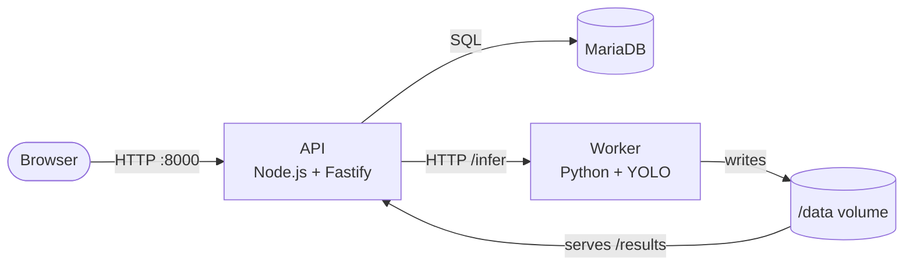
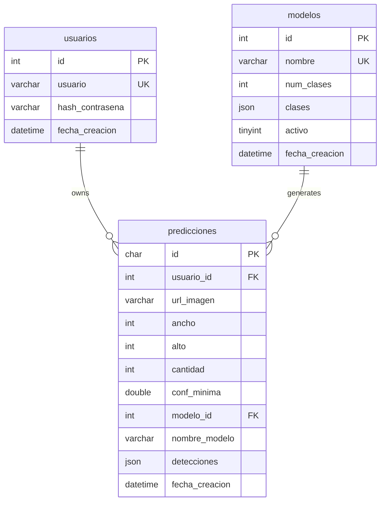

<div align="center">

# YOLO Detection Platform

**Object detection, user accounts, and prediction history — fully containerized.**

[](https://docs.docker.com/compose/)
[](https://nodejs.org/)
[](https://fastify.dev/)
[](https://www.python.org/)
[](https://docs.ultralytics.com/)
[](https://mariadb.org/)

A web app for image object detection powered by [Ultralytics YOLO](https://docs.ultralytics.com/),
with JWT authentication, per-user prediction history, and automatic model-version tracking.

</div>

---

## Table of contents

- [Overview](#overview)
- [Architecture](#architecture)
- [Quick start](#quick-start)
- [API reference](#api-reference)
- [Configuration](#configuration)
- [Using your own model](#using-your-own-model)
- [Model tracking](#model-tracking)
- [Database](#database)
- [GPU support](#gpu-support)
- [Project structure](#project-structure)
- [Troubleshooting](#troubleshooting)
- [Security notes](#security-notes)

---

## Overview

The public API is built with **Node.js + Fastify**. YOLO inference runs in a
separate **Python worker** (Ultralytics + PyTorch + OpenCV) because the library is
Python-native. The API and worker communicate over an internal HTTP call and share
the `/data` volume for annotated result images.

### Features

- **End-to-end detection** — upload an image, get an annotated result and structured detections.
- **Accounts and sessions** — registration and login with bcrypt-hashed passwords and JWT tokens.
- **Per-user history** — every prediction is stored and listed for its owner.
- **Model registry** — model versions are registered automatically on first use.
- **No frontend build step** — a single static `index.html` is served by the API.
- **CPU-first, GPU-ready** — runs on CPU by default; CUDA builds are supported.
- **Self-contained stack** — Docker Compose brings up the API, worker, and database.

---

## Architecture



| Service | Image | Responsibility |
|---|---|---|
| `api` | `node:22-alpine` | JWT auth, REST routes, history, static frontend, `/results` |
| `worker` | `python:3.11-slim` + PyTorch CPU | Loads the model and runs inference |
| `db` | `mariadb:11` | Users, models, and predictions |

Only the API is exposed to the host. The worker stays on the internal Docker
network, and MariaDB is bound to `127.0.0.1`.

---

## Quick start

### Prerequisites

- [Docker](https://docs.docker.com/get-docker/) with the Compose plugin
- Internet access on first run (to download the base model, if needed)

### Run

```bash
git clone <your-repository-url>
cd <repository-folder>
docker compose up --build
```

Open [http://localhost:8000](http://localhost:8000).

1. Register a new account or log in.
2. Upload an image and press **Detectar**.
3. The prediction is saved and appears under **Mis predicciones**.

> Ultralytics downloads the base model (`yolo11n.pt`) into `./models` the first
> time it is needed. Later runs load it from disk.

To stop the stack:

```bash
docker compose down
```

To also remove the database volume:

```bash
docker compose down -v
```

---

## API reference

All error responses use the shape `{ "detalle": "..." }`. The API keeps Spanish
field names for compatibility with the frontend and database.

| Method | Path | Auth | Description |
|---|---|---|---|
| `GET` | `/health` | — | API and database health |
| `POST` | `/auth/register` | — | JSON `{usuario, contrasena}` → access token |
| `POST` | `/auth/login` | — | JSON `{usuario, contrasena}` → access token |
| `GET` | `/auth/me` | Bearer | Current user |
| `POST` | `/predict` | Bearer | Multipart `archivo` + `conf_minima` → detections |
| `GET` | `/predictions` | Bearer | Last 100 predictions for the current user |
| `GET` | `/results/{id}.jpg` | — | Annotated result image |

### Example session

```bash
# Register (or use /auth/login)
TOKEN=$(curl -s -X POST http://localhost:8000/auth/register \
  -H 'Content-Type: application/json' \
  -d '{"usuario":"demo","contrasena":"demo1234"}' | jq -r .token_acceso)

# Run a prediction
curl -s -X POST http://localhost:8000/predict \
  -H "Authorization: Bearer $TOKEN" \
  -F "archivo=@photo.jpg" \
  -F "conf_minima=0.25" | jq

# Read the history
curl -s http://localhost:8000/predictions \
  -H "Authorization: Bearer $TOKEN" | jq
```

### Prediction response

```json
{
  "id": "a1b2c3d4e5f6a1b2c3d4e5f6a1b2c3d4",
  "url_imagen": "/results/a1b2c3d4e5f6a1b2c3d4e5f6a1b2c3d4.jpg",
  "ancho": 1280,
  "alto": 720,
  "cantidad": 2,
  "conf_minima": 0.25,
  "modelo_id": 1,
  "nombre_modelo": "56_0FA0",
  "detecciones": [
    {
      "name": "person",
      "class": 0,
      "confidence": 0.94,
      "box": { "x1": 120.5, "y1": 80.2, "x2": 410.0, "y2": 690.4 }
    }
  ]
}
```

The history endpoint adds `fecha_creacion` to each item.

---

## Configuration

Edit `.env` (or export the variables) before starting the stack. Every variable
has a default.

| Variable | Default | Description |
|---|---|---|
| `SECRET_KEY` | `cambia-esta-clave-en-produccion` | JWT signing key — **change this** |
| `ACCESS_TOKEN_EXPIRE_MINUTES` | `1440` | Token lifetime (24 h) |
| `DB_NAME` / `DB_USER` / `DB_PASSWORD` | `yolo` | MariaDB credentials |
| `DB_ROOT_PASSWORD` | `root` | MariaDB root password |
| `YOLO_MODEL` | `best.pt` | Weights file inside `/models` |
| `YOLO_CONF` | `0.25` | Default minimum confidence |
| `YOLO_DEVICE` | `cpu` | `cpu` or `0` for the first GPU |
| `MAX_UPLOAD_MB` | `15` | Maximum upload size |
| `DB_POOL_SIZE` | `10` | Database connection pool size |
| `PORT` | `8000` | API port |
| `WORKER_URL` | `http://worker:9000` | Internal worker URL |
| `RESULTS_DIR` | `/data/results` | Annotated image directory |

The worker also exposes internal endpoints (`GET /health`, `GET /model`,
`POST /infer`) on the Docker network. They are not published to the host.

---

## Using your own model

1. Copy your weights into `./models/`:

   ```bash
   cp /path/to/best.pt ./models/best.pt
   ```

2. Set the filename in `.env`:

   ```dotenv
   YOLO_MODEL=best.pt
   ```

3. Rebuild and start:

   ```bash
   docker compose up --build
   ```

If you use a different filename, update `YOLO_MODEL` accordingly.

---

## Model tracking

The `modelos` table keeps a lightweight record for each model version:

- **`nombre`** — generated automatically as `trainN_LAST4HASH` in uppercase.
  Example: training run 56 with a hash ending in `0fa0` → `56_0FA0`.
- **`num_clases` / `clases`** — exact class mapping from the checkpoint.
- **`activo`** — marks the most recently used model.
- **`fecha_creacion`** — registration timestamp.

Registration is automatic: the model row is inserted the first time the model is
used. In this deployment, `best.pt` is registered as `56_0FA0`.

Each prediction stores `modelo_id` (FK to `modelos(id)`, `ON DELETE SET NULL`) and
`nombre_modelo` (a snapshot). Replacing `best.pt` therefore does not rewrite
history: each prediction keeps the version name that produced it.

The worker extracts the training run number from the checkpoint's `train_args`
and hashes the checkpoint. Because only the last four hash characters are kept,
deduplication is by name: two different models with the same training number and
the same last four hash characters would collide (probability 1/65536).

This also handles class-ID drift between datasets: in `base_datos` (60 classes)
`0 = Aluminium foil`, while in `base_datos_v2` (15 classes) `0 = Plastic bottle`.
Storing the version makes each prediction unambiguous.

---

## Database

The API creates the schema automatically at startup with `CREATE TABLE IF NOT
EXISTS`. For manual setup or inspection, `creacion_tablas.sql` contains the DDL,
and `examples.sql` contains sample inserts.



`conf_minima` is the threshold applied to that prediction; the actual confidence
of each object is stored in `detecciones[i].confidence`.

> `examples.sql` uses placeholder bcrypt hashes and sample image paths. Do not
> treat it as production data.

---

## GPU support

By default the worker uses CPU PyTorch. To use an NVIDIA GPU:

1. Install the [NVIDIA Container Toolkit](https://docs.nvidia.com/datacenter/cloud-native/container-toolkit/latest/install-guide.html).
2. Grant the worker access to the GPU in `docker-compose.yml`:

   ```yaml
   worker:
     gpus: all
   ```

3. Set `YOLO_DEVICE=0` in `.env`.
4. Rebuild the worker with a CUDA-enabled PyTorch wheel:

   ```bash
   docker compose build \
     --build-arg TORCH_INDEX=https://download.pytorch.org/whl/cu124 \
     worker
   docker compose up
   ```

---

## Project structure

```text
.
├── api/                  # Fastify API (auth, predict, history, static frontend)
│   ├── public/           # Single-page UI
│   ├── src/              # Routes, database access, JWT helpers
│   └── Dockerfile
├── worker/               # Python inference worker (Flask + Ultralytics)
│   ├── server.py
│   └── Dockerfile
├── models/               # Model weights (Docker volume)
├── data/                 # Annotated images (shared API/worker volume)
├── legacy/               # Previous FastAPI implementation (reference only)
├── creacion_tablas.sql   # Manual database schema
├── examples.sql          # Sample inserts
├── docker-compose.yml
└── README.md
```

---

## Troubleshooting

| Symptom | Likely cause / fix |
|---|---|
| Worker takes a while to become healthy | PyTorch and the model load on startup; the health check allows a 120 s start period |
| `401 Unauthorized` | The token is missing or expired; log in again |
| `413` on upload | The image exceeds `MAX_UPLOAD_MB` |
| `502` from `/predict` | The worker is not ready or unavailable; check `docker compose logs worker` |
| `503` from `/health` | MariaDB is unreachable; check `docker compose logs db` |
| Port 8000 already in use | Change the published port in `docker-compose.yml` |

Useful commands:

```bash
docker compose ps
docker compose logs -f api
docker compose logs -f worker
docker compose logs -f db
```

---

## Security notes

- Change `SECRET_KEY`, `DB_PASSWORD`, and `DB_ROOT_PASSWORD` before deploying.
- Keep `.env` out of version control; use your platform's secret manager in production.
- The database is published only on `127.0.0.1`; change that mapping only if you need LAN access.
- The worker is not exposed to the host.
- Passwords are hashed with bcrypt. Tokens expire after 24 hours by default.
- Serve the app behind HTTPS (for example, with a reverse proxy) before exposing it publicly.

---

<div align="center">

Built with **Fastify**, **Ultralytics YOLO**, **MariaDB**, and **Docker**.

</div>
